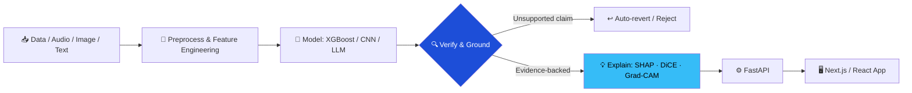

<div align="center">


<a href="https://github.com/sooraj4sure">
  
</a>

<br/><br/>

[](https://sooraj4sure.onrender.com/)
[](https://www.linkedin.com/in/suraj-kashyap-78627b243/)
[](mailto:skashyap9711@gmail.com?subject=Opportunity%20for%20Suraj%20Kumar)


</div>

---

## ⚡ Recruiter Quick Scan *(10-second read)*

<table>
<tr>
<td width="50%" valign="top">

| | |
|---|---|
| 🎯 **Role** | AI / ML Engineer (Applied NLP, XAI, CV) |
| 📍 **Location** | Delhi, India |
| 🌍 **Work mode** | Remote · Hybrid · On-site |
| 🎓 **Education** | MCA (IGNOU, 2025-) · BCA (IGNOU, 2024) |
| 💼 **Experience** | 2 ML/DS internships · 2+ yrs hands-on |
| 📧 **Contact** | [skashyap9711@gmail.com](mailto:skashyap9711@gmail.com) |

</td>
<td width="50%" valign="top">

**What I bring**

✅ ML that is **explainable**, not a black box
✅ LLM apps with **zero-hallucination guardrails**
✅ **Rigorous evaluation**: ablations, calibration, unseen-data tests
✅ **Full ownership**: model → FastAPI → Next.js UI → deploy
✅ **Cost-aware engineering**: local-first, no paid APIs where avoidable

</td>
</tr>
</table>

<div align="center">

| 🖼️ **12,000** | 🧪 **104** | 📈 **96%+** | 🤖 **5** | 💸 **$0** | 🚀 **6** |
|:---:|:---:|:---:|:---:|:---:|:---:|
| images in detector training set | automated tests in one project | test coverage | custom ML classifiers in one pipeline | recurring API cost for the meeting pipeline | shipped projects |

</div>

---

## 🧠 About Me

I'm an AI/ML engineer who cares about the part of ML most demos skip: **can you trust the output?** My projects make models *explain themselves*, make LLMs *prove their claims*, and make every result *traceable to evidence*. I back that up with real engineering: tests, evaluation suites, calibration, and deployed apps.

```python
class Suraj:
    role        = "AI / ML Engineer"
    strengths   = ["Explainable AI", "LLM grounding & verification",
                   "Audio & vision pipelines", "Full-stack delivery"]
    principles  = ["Evidence first", "Verify, don't trust", "Test like it's production",
                   "Make it work → make it explainable → make it fast"]
    exploring   = ["LLM agents", "Responsible AI", "Advanced PyTorch", "Local-first ML"]
```

---

## 🚀 Featured Projects

### ✈️ JobPilot: Resume Tailoring & Interview Prep Copilot
`Next.js` `TypeScript` `Tailwind CSS` `Gemini API`

| | |
|---|---|
| **Problem** | LLM resume tools invent experience, which is dangerous for job seekers. |
| **Approach** | A 3-stage pipeline (fit scoring → bullet tailoring → gap-targeted interview questions) with a **two-call generate-and-verify** architecture. |
| **Result** | Any bullet with an unsupported claim is **automatically reverted**, so the output stays truthful. |

[🔗 Repository](https://github.com/sooraj4sure?tab=repositories&q=jobpilot)

---

### 🏦 Counterfactual Loan Explainer: Interpretable Credit Decisioning
`Python` `XGBoost` `SHAP` `DiCE` `FastAPI` `Next.js`

| | |
|---|---|
| **Problem** | Lending decisions need explanations that are accurate, not just plausible. |
| **Approach** | XGBoost model + **SHAP** (why) + **DiCE** (what would change the decision), narrated by an LLM under a **strict grounding contract**. |
| **Result** | The chatbot reports only computed SHAP/DiCE facts, never free-form reasoning, which meets regulatory-grade accuracy expectations. |

[🔗 Repository](https://github.com/sooraj4sure?tab=repositories&q=loan)

---

### 🎙️ Meeting Intelligence System: Local-First Audio → Insights
`Python` `FastAPI` `faster-whisper` `pyannote.audio` `scikit-learn` `PostgreSQL + pgvector` `React`

| | |
|---|---|
| **Problem** | Meeting AI tools are costly, cloud-bound and hard to audit. |
| **Approach** | Local ASR + speaker diarization + **5 custom scikit-learn classifiers**, stored in an **evidence-first** schema (pgvector). |
| **Result** | **Zero paid APIs, zero recurring cost.** Every decision and action item links to its source transcript segment and confidence score. |

[🔗 Repository](https://github.com/sooraj4sure?tab=repositories&q=meeting)

---

### 🕵️ ImageForensics AI: Real vs. AI-Generated Image Detection
`Python` `PyTorch` `ResNet-18` `FastAPI` `Streamlit`

| | |
|---|---|
| **Problem** | Detectors often work only on the generators they were trained on. |
| **Approach** | Multi-branch CNN fusing **RGB + frequency + noise-residual** signals, trained on **12,000 images** from Stable Diffusion, GAN and Midjourney (one family **held out** to test generalization). |
| **Result** | Full evaluation: ablation study, unseen-generator testing, robustness suite, temperature-scaling calibration and **Grad-CAM** explanations, validated by **104 tests at 96%+ coverage**. |

[🔗 Repository](https://github.com/sooraj4sure?tab=repositories&q=forensics)

---

<details>
<summary><b>🛠️ More projects (full-stack & AI apps)</b></summary>
<br/>

| Project | Description | Stack | Link |
|---|---|---|---|
| **AutoVibe** | E-commerce platform for car accessories with catalog, order flows and Cloudinary media handling | `Next.js` `MongoDB` `REST` `Cloudinary` | [Repos](https://github.com/sooraj4sure?tab=repositories&q=autovibe) |
| **Sketi** | AI image generator with history and download | `React` `HuggingFace API` | [Live](https://sketi.onrender.com) |
| **Sylvie** | Context-aware AI chat partner | `React` `Groq API` | [Live](https://sylvie-pink.vercel.app/) |
| **WeMeet** | Real-time one-on-one video calling | `React` `WebRTC` `Socket.IO` `Node.js` | [Live](https://wemeet-video-calling-app.onrender.com/) |
| **Portfolio** | Responsive personal portfolio | `React` `Tailwind` | [Live](https://sooraj4sure.onrender.com/) |

</details>

---

## 🧩 My Approach to Trustworthy AI



---

## 🛠️ Tech Arsenal

<div align="center">


-2496ED?style=flat-square&logo=docker&logoColor=white)


</div>

<details>
<summary><b>📋 Full skills breakdown</b></summary>
<br/>

| Area | Skills |
|---|---|
| **ML & AI** | Supervised/Unsupervised Learning, Deep Learning, NLP (NLTK), Explainable AI (SHAP, DiCE), EDA, Data Preprocessing, Feature Engineering, Model Evaluation |
| **Data & Viz** | Matplotlib, Seaborn, Plotly, Jupyter, SQL, MySQL, PostgreSQL/pgvector |
| **Backend & APIs** | FastAPI, Node.js, Express.js, REST APIs, MongoDB, Gemini API |
| **Frontend** | React, Next.js, TypeScript, Tailwind CSS, Bootstrap, Responsive Design |
| **Tools** | Git, GitHub, Docker (basic), Streamlit, Cloudinary |

</details>

---

## 💼 Experience

```text
2025 ─── Machine Learning Intern · Codec Technologies · 4 months
         • Data preprocessing, EDA and model-building workflows in Python
         • End-to-end ML fundamentals: cleaning → feature engineering → evaluation

     ─── Data Science Intern · Technex, IIT (BHU) Varanasi · 2 months
         • Built a Titanic survival prediction model with scikit-learn
           (data cleaning, feature engineering, classification evaluation)
```

---

## 🏆 Education & Certifications

| 🎖️ Certification | 🏛️ Issuer | 📅 |
|---|---|---|
| Prompt Engineering & Programming with OpenAI | Columbia+ | Aug 2025 |
| CS50: Introduction to Programming with Python | Harvard University | Jul 2025 |
| Cloud Computing | NIELIT Delhi | Jan 2025 |
| Machine Learning to Deep Learning | ISRO | Jul 2022 |

🎓 **MCA**: Indira Gandhi National Open University (Jan 2025 - Present)
🎓 **BCA**: Indira Gandhi National Open University (Jan 2021 - Jan 2024)

---

## 📊 GitHub Activity

<div align="center">


</div>

---

## 🤝 Let's Work Together

I'm looking for **AI/ML Engineer** roles (applied NLP, LLM systems, explainable ML, computer vision) where trustworthy, well-tested AI matters, and I can own the work from model to deployed product.

<div align="center">

[](mailto:skashyap9711@gmail.com?subject=Opportunity%20for%20Suraj%20Kumar)
[](https://www.linkedin.com/in/suraj-kashyap-78627b243/)
[](https://sooraj4sure.onrender.com/)

<br/>

*"Make it work, make it explainable, then make it fast."*


</div>
