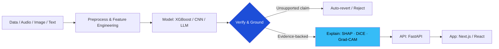

<!-- HEADER -->
<div align="center">


<a href="https://github.com/sooraj4sure">
  
</a>

<br/>

📍 Delhi, India &nbsp;|&nbsp; 🎓 MCA Candidate @ IGNOU &nbsp;|&nbsp; 🌍 Open to Remote / Hybrid / On-site

<br/>

[](https://sooraj4sure.onrender.com/)
[](https://www.linkedin.com/in/suraj-kashyap-78627b243/)
[](mailto:skashyap9711@gmail.com)


</div>

---

## 👋 About Me

I'm an **AI/ML Engineer** who likes the hard part of machine learning: making models **explainable, grounded and auditable**, not just accurate. I've shipped independent projects across **LLM pipelines, explainable ML, audio intelligence and computer vision**, and I can take them end to end because I also build full-stack (Next.js, MERN).

```python
class Suraj:
    role        = "AI / ML Engineer"
    based_in    = "Delhi, India 🇮🇳"
    education   = ["MCA (IGNOU, 2025 - present)", "BCA (IGNOU, 2021 - 2024)"]
    experience  = ["ML Intern @ Codec Technologies", "Data Science Intern @ Technex, IIT (BHU) Varanasi"]
    superpower  = "Turning ML models into trustworthy, deployed products"
    principles  = ["Ground every LLM output in facts", "Evidence first, always auditable",
                   "Zero hallucinations > fancy demos", "Test like it's production"]

    def currently_exploring(self):
        return ["Generative AI & LLM agents", "Explainable / Responsible AI",
                "Deep Learning (PyTorch)", "Local-first, privacy-friendly ML"]
```

---

## 🚀 Featured Projects

<table>
<tr>
<td width="50%" valign="top">

### ✈️ JobPilot
**Resume Tailoring & Interview Prep Copilot**

`Next.js` `TypeScript` `Tailwind CSS` `Gemini API`

- 3-stage LLM pipeline: scores resume ↔ JD fit, tailors bullets, generates gap-targeted interview questions
- **Generate-and-verify** design: a second call audits every bullet and **auto-reverts any unsupported claim**, so no hallucinated experience

[🔗 Repo](https://github.com/sooraj4sure?tab=repositories&q=jobpilot)

</td>
<td width="50%" valign="top">

### 🏦 Counterfactual Loan Explainer
**Interpretable ML Credit-Decisioning Chatbot**

`Python` `XGBoost` `SHAP` `DiCE` `FastAPI` `Next.js`

- Explains credit decisions in plain language, with *why* (SHAP) and *what would change it* (DiCE counterfactuals)
- Strict **LLM grounding contract**: narration reports only computed facts, never free-form reasoning, for regulatory-grade accuracy

[🔗 Repo](https://github.com/sooraj4sure?tab=repositories&q=loan)

</td>
</tr>
<tr>
<td width="50%" valign="top">

### 🎙️ Meeting Intelligence System
**Local-First Audio → Insights Pipeline**

`Python` `FastAPI` `faster-whisper` `pyannote.audio` `scikit-learn` `PostgreSQL/pgvector` `React`

- ASR + speaker diarization + **5 custom scikit-learn classifiers**, with **zero paid APIs and zero recurring cost**
- **Evidence-first** architecture: every decision or action item links to its source transcript segment and confidence score

[🔗 Repo](https://github.com/sooraj4sure?tab=repositories&q=meeting)

</td>
<td width="50%" valign="top">

### 🕵️ ImageForensics AI
**Explainable Real vs. AI-Generated Image Detector**

`Python` `PyTorch` `ResNet-18` `FastAPI` `Streamlit`

- Multi-branch CNN fusing **RGB + frequency + noise-residual** signals, trained on 12,000 images across Stable Diffusion, GAN and Midjourney
- Ablations, **unseen-generator** testing, robustness suite, temperature-scaling calibration and **Grad-CAM**; **104 tests at 96%+ coverage**

[🔗 Repo](https://github.com/sooraj4sure?tab=repositories&q=forensics)

</td>
</tr>
</table>

<details>
<summary><b>🛠️ More projects (full-stack)</b></summary>
<br/>

| Project | What it is | Stack |
|---|---|---|
| **AutoVibe** | E-commerce platform for car accessories: product catalog, order flows, Cloudinary media uploads | `Next.js` `MongoDB` `Cloudinary` `REST` `Tailwind` |
| **Sketi** | AI image generator with history and downloads | `React` `HuggingFace API` |
| **Sylvie** | Context-aware AI chat partner | `React` `Groq API` |
| **WeMeet** | Real-time one-on-one video calling | `React` `WebRTC` `Socket.IO` `Node.js` |
| **Portfolio** | Responsive personal site | `React` `Tailwind` |

[🔗 Sketi](https://sketi.onrender.com) · [🔗 Sylvie](https://sylvie-pink.vercel.app/) · [🔗 WeMeet](https://wemeet-video-calling-app.onrender.com/) · [🔗 Portfolio](https://sooraj4sure.onrender.com/)

</details>

---

## 🧩 How I Build: *Trustworthy AI*



---

## 🧠 Tech Arsenal

<div align="center">

**Machine Learning & AI**


`NLP (NLTK)` · `SHAP` · `DiCE` · `Explainable AI` · `Feature Engineering` · `Model Evaluation` · `EDA`

**Data & Visualization**


`Matplotlib` · `Seaborn` · `SQL`

**Backend & APIs**


**Frontend**


**Tools & Deployment**


-2496ED?style=for-the-badge&logo=docker&logoColor=white)


</div>

---

## 💼 Experience

| Role | Where | Duration | Highlights |
|---|---|---|---|
| **Machine Learning Intern** | Codec Technologies | 4 months | Data preprocessing, EDA, model-building workflows, and the end-to-end ML cycle (cleaning → feature engineering → evaluation) in Python |
| **Data Science Intern** | Technex, IIT (BHU) Varanasi | 2 months | Built a Titanic survival prediction model: data cleaning, feature engineering, classification evaluation with scikit-learn |

---

## 🏆 Certifications & Education

| 🎖️ Certification | 🏛️ Issuer | 📅 Date |
|---|---|---|
| Prompt Engineering & Programming with OpenAI | Columbia+ | Aug 2025 |
| CS50: Introduction to Programming with Python | Harvard University | Jul 2025 |
| Cloud Computing | NIELIT Delhi | Jan 2025 |
| Machine Learning to Deep Learning | ISRO | Jul 2022 |

🎓 **MCA**, Indira Gandhi National Open University (Jan 2025 - Present)
🎓 **BCA**, Indira Gandhi National Open University (Jan 2021 - Jan 2024)

---

## 📊 GitHub Stats

<div align="center">


</div>

---

## 🎯 What I'm Looking For

- 🤖 **AI/ML Engineer** roles: applied NLP, LLM systems, explainable ML, computer vision
- 🌐 Teams that value **grounded, testable, auditable** AI over black-box demos
- 🚀 Opportunities to own the **full lifecycle**: model → API → deployed app
- 🤝 **Open-source** collaboration on responsible-AI tooling

> 💬 *Have a problem that needs ML with receipts? Let's talk.*

<div align="center">

[](mailto:skashyap9711@gmail.com)
[](https://www.linkedin.com/in/suraj-kashyap-78627b243/)
[](https://sooraj4sure.onrender.com/)

<br/>

*"Make it work, make it explainable, then make it fast."*


</div>
