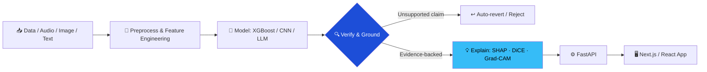

<div align="center">


<a href="https://github.com/sooraj4sure">
  
</a>

<br/>


<br/><br/>

[](https://sooraj4sure.onrender.com/)
[](https://www.linkedin.com/in/suraj-kashyap-78627b243/)
[](mailto:skashyap9711@gmail.com?subject=Opportunity%20for%20Suraj%20Kumar)


</div>


##  Recruiter Quick Scan <sub>(10-second read)</sub>

<div align="center">


</div>

<table>
<tr>
<td width="55%" valign="top">

**What I bring**

 ML that is **explainable**, not a black box
<br/> LLM apps with **zero-hallucination guardrails**
<br/> **Rigorous evaluation**: ablations, calibration, unseen-data tests
<br/> **Full ownership**: model → FastAPI → Next.js UI → deploy
<br/> **Cost-aware engineering**: local-first, no paid APIs where avoidable

<br/>

📧 [skashyap9711@gmail.com](mailto:skashyap9711@gmail.com) &nbsp;·&nbsp; 🎓 MCA (IGNOU, 2025-) · BCA (IGNOU, 2024)

</td>
<td width="45%" align="center" valign="middle">


</td>
</tr>
</table>

<div align="center">


</div>


##  About Me

I'm an AI/ML engineer who cares about the part of ML most demos skip: **can you trust the output?** My projects make models *explain themselves*, make LLMs *prove their claims*, and make every result *traceable to evidence*. I back that up with real engineering: tests, evaluation suites, calibration, and deployed apps.

```python
class Suraj:
    role        = "AI / ML Engineer"
    strengths   = ["Explainable AI", "LLM grounding & verification",
                   "Audio & vision pipelines", "Full-stack delivery"]
    principles  = ["Evidence first", "Verify, don't trust", "Test like it's production",
                   "Make it work → make it explainable → make it fast"]
    exploring   = ["LLM agents", "Responsible AI", "Advanced PyTorch", "Local-first ML"]
```

<div align="center">
  
</div>


##  Featured Projects

###  JobPilot: Resume Tailoring & Interview Prep Copilot
   

| | |
|---|---|
| **Problem** | LLM resume tools invent experience, which is dangerous for job seekers. |
| **Approach** | A 3-stage pipeline (fit scoring → bullet tailoring → gap-targeted interview questions) with a **two-call generate-and-verify** architecture. |
| **Result** | Any bullet with an unsupported claim is **automatically reverted**, so the output stays truthful. |

[🔗 Repository](https://github.com/sooraj4sure?tab=repositories&q=jobpilot)

###  Counterfactual Loan Explainer: Interpretable Credit Decisioning
     

| | |
|---|---|
| **Problem** | Lending decisions need explanations that are accurate, not just plausible. |
| **Approach** | XGBoost model + **SHAP** (why) + **DiCE** (what would change the decision), narrated by an LLM under a **strict grounding contract**. |
| **Result** | The chatbot reports only computed SHAP/DiCE facts, never free-form reasoning, which meets regulatory-grade accuracy expectations. |

[🔗 Repository](https://github.com/sooraj4sure?tab=repositories&q=loan)

###  Meeting Intelligence System: Local-First Audio → Insights
      

| | |
|---|---|
| **Problem** | Meeting AI tools are costly, cloud-bound and hard to audit. |
| **Approach** | Local ASR + speaker diarization + **5 custom scikit-learn classifiers**, stored in an **evidence-first** schema (pgvector). |
| **Result** | **Zero paid APIs, zero recurring cost.** Every decision and action item links to its source transcript segment and confidence score. |

[🔗 Repository](https://github.com/sooraj4sure?tab=repositories&q=meeting)

###  ImageForensics AI: Real vs. AI-Generated Image Detection
    

| | |
|---|---|
| **Problem** | Detectors often work only on the generators they were trained on. |
| **Approach** | Multi-branch CNN fusing **RGB + frequency + noise-residual** signals, trained on **12,000 images** from Stable Diffusion, GAN and Midjourney (one family **held out** to test generalization). |
| **Result** | Full evaluation: ablation study, unseen-generator testing, robustness suite, temperature-scaling calibration and **Grad-CAM** explanations, validated by **104 tests at 96%+ coverage**. |

[🔗 Repository](https://github.com/sooraj4sure?tab=repositories&q=forensics)

<details>
<summary><b>🛠️ More projects (full-stack & AI apps)</b></summary>
<br/>

| Project | Description | Stack | Link |
|---|---|---|---|
| **AutoVibe** | E-commerce platform for car accessories with catalog, order flows and Cloudinary media handling | `Next.js` `MongoDB` `REST` `Cloudinary` | [Repos](https://github.com/sooraj4sure?tab=repositories&q=autovibe) |
| **Sketi** | AI image generator with history and download | `React` `HuggingFace API` | [Live](https://sketi.onrender.com) |
| **Sylvie** | Context-aware AI chat partner | `React` `Groq API` | [Live](https://sylvie-pink.vercel.app/) |
| **WeMeet** | Real-time one-on-one video calling | `React` `WebRTC` `Socket.IO` `Node.js` | [Live](https://wemeet-video-calling-app.onrender.com/) |
| **Portfolio** | Responsive personal portfolio | `React` `Tailwind` | [Live](https://sooraj4sure.onrender.com/) |

</details>


##  My Approach to Trustworthy AI




##  Tech Arsenal

<div align="center">


<br/><br/>


</div>

<details>
<summary><b>📋 Full skills breakdown</b></summary>
<br/>

| Area | Skills |
|---|---|
| **ML & AI** | Supervised/Unsupervised Learning, Deep Learning, NLP (NLTK), Explainable AI (SHAP, DiCE), EDA, Data Preprocessing, Feature Engineering, Model Evaluation |
| **Data & Viz** | Matplotlib, Seaborn, Plotly, Jupyter, SQL, MySQL, PostgreSQL/pgvector |
| **Backend & APIs** | FastAPI, Node.js, Express.js, REST APIs, MongoDB, Gemini API |
| **Frontend** | React, Next.js, TypeScript, Tailwind CSS, Bootstrap, Responsive Design |
| **Tools** | Git, GitHub, Docker (basic), Streamlit, Cloudinary |

</details>


##  Experience

```text
2025 ─── Machine Learning Intern · Codec Technologies · 4 months
         • Data preprocessing, EDA and model-building workflows in Python
         • End-to-end ML fundamentals: cleaning → feature engineering → evaluation

     ─── Data Science Intern · Technex, IIT (BHU) Varanasi · 2 months
         • Built a Titanic survival prediction model with scikit-learn
           (data cleaning, feature engineering, classification evaluation)
```


##  Education & Certifications

| 🎖️ Certification | 🏛️ Issuer | 📅 |
|---|---|---|
| Prompt Engineering & Programming with OpenAI | Columbia+ | Aug 2025 |
| CS50: Introduction to Programming with Python | Harvard University | Jul 2025 |
| Cloud Computing | NIELIT Delhi | Jan 2025 |
| Machine Learning to Deep Learning | ISRO | Jul 2022 |

🎓 **MCA**: Indira Gandhi National Open University (Jan 2025 - Present)
🎓 **BCA**: Indira Gandhi National Open University (Jan 2021 - Jan 2024)


##  GitHub Activity

<div align="center">


</div>


##  Let's Work Together

I'm looking for **AI/ML Engineer** roles (applied NLP, LLM systems, explainable ML, computer vision) where trustworthy, well-tested AI matters, and I can own the work from model to deployed product.

<div align="center">


[](mailto:skashyap9711@gmail.com?subject=Opportunity%20for%20Suraj%20Kumar)
[](https://www.linkedin.com/in/suraj-kashyap-78627b243/)
[](https://sooraj4sure.onrender.com/)

<br/>

*"Make it work, make it explainable, then make it fast."*


</div>
